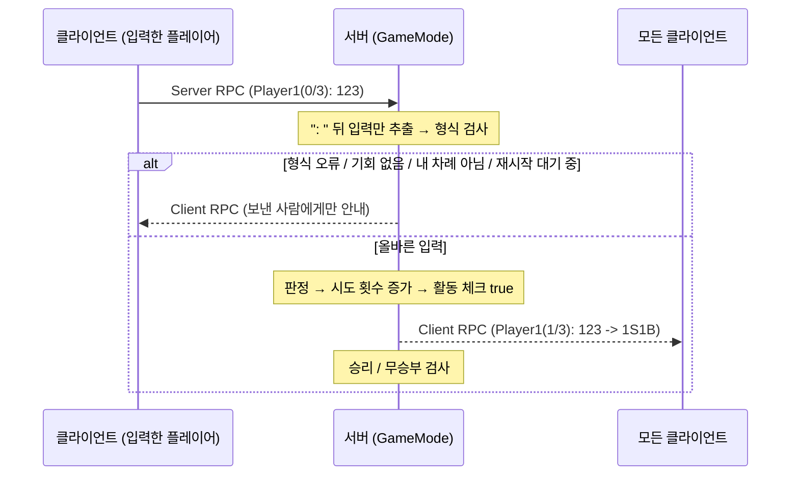

# NuriChat - 멀티플레이 숫자 야구

채팅창에 숫자 세 자리를 입력해서, 서버가 정한 정답을 먼저 맞히는 턴제 멀티플레이 숫자 야구 게임입니다.
정답 판정부터 시도 횟수, 턴 시간까지 게임 규칙은 전부 데디케이티드 서버의 GameMode가 처리하고, 클라이언트는 입력과 화면 표시만 맡도록 만들었습니다.

- 엔진: Unreal Engine 5.5 (C++)
- 과제: 내일배움캠프 Unreal 10기 CH4 1번 과제
- 시연 영상: (추가 예정)

---

## 실행 방법

1. `NuriChat.uproject`를 열고 `Content/NuriChat/Maps/Chatting` 맵을 엽니다.
2. Play 옵션에서 Net Mode를 Play As Client, Number of Players를 2로 두고 실행합니다.
3. 채팅창에 숫자 세 자리를 입력하고 Enter를 누르면 됩니다.
4. 테스트할 때는 서버 콘솔 창에 정답이 빨간 글자로 찍히니 참고하시면 됩니다.

---

## 게임 규칙

- 서버가 1~9 중 서로 다른 숫자 세 개로 정답을 만듭니다. (예: 386)
- 플레이어는 차례대로 한 번씩 숫자를 입력하고, 한 턴은 15초입니다.
- 숫자와 자리가 모두 맞으면 S(Strike), 숫자는 있는데 자리가 다르면 B(Ball), 하나도 없으면 OUT입니다.
- 기회는 한 사람당 3번입니다.
- 누군가 3S를 맞히면 승리, 모두 기회를 다 쓰면 무승부이고, 어느 쪽이든 10초 뒤에 새 게임이 시작됩니다.
- 숫자가 없는 일반 채팅은 차례와 상관없이 언제든 보낼 수 있습니다.

---

## 구현 기능

### 필수 기능
- 멀티플레이 채팅 (입력 위젯 → Server RPC → GameMode → 모든 플레이어에게 Client RPC)
- 게임 시작 시 서버에서 1~9 중 중복 없는 세 자리 정답 생성
- 입력 검사: 세 자리인지, 문자나 0이 섞였는지, 중복 숫자가 있는지 확인하고, 규칙에 안 맞으면 보낸 사람에게만 "다시 입력하세요"를 띄웁니다. 이때 기회는 깎지 않습니다.
- S / B / OUT 판정 ("1S1B", "OUT" 형식 문자열)
- PlayerState로 플레이어별 시도 횟수 관리, 판정 메시지에 `Player1(1/3): 123 -> 1S1B`처럼 서버 기준 횟수 표시
- 기회를 다 쓴 플레이어의 입력은 서버에서 거절
- 승리 / 무승부 공지와 게임 리셋
- C++ 함수 라이브러리 `NuriChatFunctionLibrary` (화면 출력, NetMode / NetRole 문자열 변환)

### 도전 기능
- 화면에 `Player1의 차례 - 남은 시간 12초` 형태의 턴 타이머 표시
- 남은 시간은 서버가 관리하고, GameState 복제 변수를 위젯에 바인딩해서 모든 플레이어가 같은 시간을 보게 했습니다.
- 0초가 되었거나, 내 차례가 아니거나, 이번 턴에 이미 입력했다면 서버가 입력을 받지 않습니다.
- 이번 턴에 숫자를 입력했는지 확인하는 활동 체크 변수(`bHasGuessedThisTurn`)
- 숫자를 입력하거나 시간이 끝나면 다음 플레이어에게 차례가 넘어갑니다.
- 아무것도 입력하지 않고 시간이 끝나면 시도 횟수가 1회 차감됩니다.

### 추가로 넣은 것
- 승리 / 무승부 후 10초 기다렸다가 자동 재시작
  - 처음에는 승리하자마자 바로 재시작되게 만들었는데, 직접 플레이해 보니 승리 문구만 남은 채로 다음 판이 이어져서 게임이 끝난 건지 새로 시작한 건지 화면만 봐서는 알기 어려웠습니다. 흐름이 어색하다고 느껴서, 결과를 볼 시간을 주고 "10초 후 재시작됩니다"로 다음 판 시작을 알려주도록 바꿨습니다.
- 턴 시간(`TurnTimeLimit`)과 재시작 대기 시간(`RestartDelay`)은 블루프린트에서 바꿀 수 있고, 공지에 나오는 숫자도 이 값을 따라갑니다.

---

## 구현 과정

### 1. 멀티플레이 채팅
채팅 위젯(`UNCChatInput`)에서 Enter를 누르면 PlayerController로 문장이 넘어가고, PlayerController가 Server RPC로 서버의 GameMode에 전달합니다. GameMode는 모든 PlayerController에 Client RPC를 보내서 각자 화면에 띄웁니다. 누가 접속했는지는 GameState의 NetMulticast RPC로 알렸습니다.

### 2. 정답 생성과 판정
정답은 1~9가 들어 있는 배열에서 하나를 뽑을 때마다 그 숫자를 배열에서 지우는 방식으로 만들어서, 중복이 생길 수 없게 했습니다. 입력 검사는 `TSet`에 숫자를 넣어서 크기로 중복을 확인했고, 판정 결과는 "1S1B", "OUT" 같은 문자열로 돌려주도록 했습니다.

### 3. 시도 횟수
플레이어 이름과 현재 / 최대 시도 횟수는 PlayerState에 복제 변수로 두고, `GetPlayerInfoString()`으로 `Player1(1/3)` 형태의 이름표를 만들었습니다.

### 4. 승리 / 무승부 / 리셋
결과는 PlayerController의 복제 변수 `NotificationText`에 넣고, 공지 위젯이 이 값을 바인딩해서 보여줍니다.

### 5. 필수 기능 마무리
여기까지 만들고 테스트하면서 빈 곳을 채웠습니다. 기회를 다 써도 계속 입력이 되던 문제, 잘못된 입력이 아무 안내 없이 채팅으로 나가던 문제, 판정 메시지의 횟수가 한 박자 늦게 보이던 문제를 고쳤고, 한 판에 정답이 여러 번 바뀌던 버그도 이때 찾았습니다. (아래 트러블슈팅 1번)

### 6. 도전 기능: 턴 타이머와 턴 전환
남은 시간과 현재 차례를 GameState에 복제 변수로 추가하고, GameMode에서 1초마다 도는 타이머로 시간을 줄였습니다. 위젯은 GameState 값을 바인딩해서 표시하고, 입력이 들어오면 활동 체크 변수만 켜 두었다가 다음 타이머 때 차례를 넘기도록 했습니다.

### 7. 추가로 만든 것: 승리 / 무승부 후 10초 뒤 재시작
과제 기능을 다 만들고 직접 플레이해 보니, 승리하자마자 바로 다음 판이 시작돼서 게임이 끝난 건지 새로 시작한 건지 알기 어려웠습니다. 그래서 과제에는 없던 기능이지만 승리 / 무승부 공지를 띄운 뒤 10초를 기다렸다가 재시작하도록 추가했습니다. 기다리는 동안에는 턴 시간이 멈추고 숫자 입력도 받지 않습니다.

이 기능을 만들면서 늦게 접속한 플레이어만 시작 공지를 못 받는 문제도 발견해서 같이 고쳤습니다. (아래 트러블슈팅 2번)

---

## 구조

### 클래스별 역할
- `ANCGameModeBase` (서버에만 존재): 정답 생성, 입력 검사, 판정, 승리 / 무승부 / 리셋, 1초 턴 타이머와 턴 전환
- `ANCGameStateBase` (서버와 모든 클라이언트): 모두가 봐야 하는 값(`RemainingTurnTime`, `CurrentTurnPlayerName`) 복제, 접속 안내 Multicast
- `ANCPlayerController`: 채팅을 서버로 보내는 Server RPC, 결과를 받는 Client RPC, 공지 문구 `NotificationText`
- `ANCPlayerState`: 플레이어 이름, 현재 / 최대 시도 횟수
- `UNCChatInput`: Enter를 누르면 PlayerController로 문장 전달
- `WBP_NotificationText`: 공지와 턴 타이머를 바인딩으로 표시

### 숫자를 입력했을 때



### 턴 타이머 (서버에서 1초마다)
1. 재시작을 기다리는 중이면 아무것도 하지 않습니다.
2. 아직 첫 턴 전이면 "야구게임 시작!" 공지를 띄우고 첫 플레이어에게 차례를 줍니다.
3. 이번 턴에 입력이 있었으면 다음 플레이어로 넘깁니다.
4. 입력이 없었으면 남은 시간을 1 줄이고, 0이 되면 시도 횟수를 1회 차감한 뒤 다음 플레이어로 넘깁니다.
5. 바뀐 값은 GameState를 통해 모든 클라이언트에 복제되고, 위젯이 그대로 보여줍니다.

---

## 핵심 코드

코드는 [`NCGameModeBase.cpp`](Source/NuriChat/Game/NCGameModeBase.cpp), [`NCGameStateBase.h`](Source/NuriChat/Game/NCGameStateBase.h)에서 가져왔고, 길어지는 부분은 `...`로 줄였습니다.

### 1. TSet으로 중복 검사
세 자리인지, 1~9 숫자만 있는지 본 다음 `TSet`에 넣습니다. TSet은 같은 값을 한 번만 저장하니까, 세 개를 넣었는데 크기가 3이 아니면 중복이 있다는 뜻입니다.

```cpp
bool ANCGameModeBase::IsGuessNumberString(const FString& InNumberString)
{
	bool bCanPlay = false;

	do {
		if (InNumberString.Len() != 3) // 자리수 3개 아니면 막기
		{
			break;
		}

		bool bIsUnique = true;
		TSet<TCHAR> UniqueDigits;
		for (TCHAR C : InNumberString)
		{
			if (FChar::IsDigit(C) == false || C == '0') // 문자나 0이 섞이면 실패
			{
				bIsUnique = false;
				break;
			}
			UniqueDigits.Add(C);
		}

		if (bIsUnique == false)
		{
			break;
		}

		if (UniqueDigits.Num() != 3) // TSet은 중복을 안 받으니, 3개가 안 되면 중복 처리
		{
			break;
		}

		bCanPlay = true;
	} while (false);

	return bCanPlay;
}
```

### 2. 서버에서 입력 받기
클라이언트는 `Player1(1/3): 123`처럼 이름표를 붙여서 보내는데, 이름표 안에도 숫자가 있어서 메시지 전체를 검사하면 모든 채팅이 게임 입력으로 잡힙니다. 그래서 `": "` 뒤만 꺼내서 검사하도록 했습니다. 입력을 거절할 때는 그 플레이어의 PlayerController로 Client RPC를 보내서 본인에게만 이유를 알려줍니다.

```cpp
void ANCGameModeBase::PrintChatMessageString(ANCPlayerController* InChattingPlayerController, const FString& InChatMessageString)
{
	// 클라가 보낸 문자열은 "Player1(1/3): 입력" 모양이라, ": " 뒤의 실제 입력만 꺼냄
	FString PlayerInfoString;
	FString GuessNumberString;
	if (InChatMessageString.Split(TEXT(": "), &PlayerInfoString, &GuessNumberString) == false)
	{
		GuessNumberString = InChatMessageString;
	}
	GuessNumberString.TrimStartAndEndInline();

	// 숫자가 하나라도 있으면 게임 입력을 하려던 것으로 봄
	bool bHasDigit = false;
	...

	// 게임 입력인데 규칙에 안 맞으면 보낸 사람에게만 안내 (기회 소진 없음)
	if (bHasDigit == true && IsGuessNumberString(GuessNumberString) == false)
	{
		InChattingPlayerController->ClientRPCPrintChatMessageString(TEXT("다시 입력하세요. (1~9 중 서로 다른 숫자 3개)"));
		return;
	}

	if (IsGuessNumberString(GuessNumberString) == true)
	{
		// 재시작 대기 중 / 기회 소진 검사
		...

		// 턴 검사: 내 차례가 아니거나, 이번 턴에 이미 입력했거나, 0초면 서버가 받지 않음
		bool bIsMyTurn = AllPlayerControllers.IsValidIndex(CurrentTurnIndex) == true && AllPlayerControllers[CurrentTurnIndex] == InChattingPlayerController;
		if (bIsMyTurn == false || bHasGuessedThisTurn == true || (IsValid(NCGameStateBase) == true && NCGameStateBase->RemainingTurnTime <= 0))
		{
			InChattingPlayerController->ClientRPCPrintChatMessageString(TEXT("지금은 입력할 수 없습니다. (현재 차례: ") + TurnPlayerName + TEXT(")"));
			return;
		}
		bHasGuessedThisTurn = true; // 활동 체크: 이번 턴에 입력함 → 다음 타이머 때 차례가 넘어감

		// 판정 → 시도 횟수 증가 → 모두에게 결과 전송 → 승리/무승부 검사 (반복문 밖에서 1번)
		...
	}
	...
}
```

### 3. GameState 복제 변수
남은 시간과 현재 차례는 모든 플레이어가 계속 봐야 하는 값이라 GameState에 복제 변수로 뒀습니다. 값은 서버에서만 바꾸고, 위젯은 바인딩으로 읽기만 합니다.

```cpp
// NCGameStateBase.h
// 남은 턴 시간(초). 서버가 줄이고 모든 클라에 복제됨 → 위젯이 바인딩해서 표시
UPROPERTY(Replicated, BlueprintReadOnly)
int32 RemainingTurnTime = 0;

// 지금 차례인 플레이어 이름 (위젯 표시용)
UPROPERTY(Replicated, BlueprintReadOnly)
FString CurrentTurnPlayerName;
```

### 4. 턴 타이머
`BeginPlay`에서 `SetTimer`로 1초마다 부르는 함수입니다. 차례를 넘기는 코드가 여기저기 흩어지지 않도록 이 함수 하나에 모았습니다.

```cpp
void ANCGameModeBase::OnTurnTimerElapsed()
{
	...
	if (GetWorldTimerManager().IsTimerActive(RestartTimerHandle) == true)
	{
		return; // 재시작 대기 중에는 턴 시간 멈춤
	}

	// 첫 턴 시작 ("야구게임 시작!" 공지 후 첫 플레이어에게 차례)
	if (CurrentTurnIndex == -1)
	{
		...
		MoveToNextTurn();
		return;
	}

	// 이번 턴에 숫자를 입력했으면 다음 사람 차례
	if (bHasGuessedThisTurn == true)
	{
		MoveToNextTurn();
		return;
	}

	NCGameStateBase->RemainingTurnTime--;
	if (NCGameStateBase->RemainingTurnTime > 0)
	{
		return;
	}

	// 입력 없이 시간이 끝남 → 기회 1회 차감
	...
	IncreaseGuessCount(TurnPlayerController);
	TurnPlayerController->ClientRPCPrintChatMessageString(TEXT("시간 초과! 기회 1회가 차감됩니다."));
	JudgeGame(TurnPlayerController, 0); // 모두 기회를 다 썼으면 무승부 처리

	MoveToNextTurn();
}
```

### 5. 다음 차례 찾기
지금 차례 다음 칸부터 순서대로 다음 플레이어를 찾습니다. `%` 연산으로 마지막 플레이어 다음에는 다시 첫 플레이어로 돌아오게 했습니다.

```cpp
void ANCGameModeBase::MoveToNextTurn()
{
	...
	for (int32 Step = 1; Step <= AllPlayerControllers.Num(); ++Step)
	{
		int32 NextIndex = (CurrentTurnIndex + Step) % AllPlayerControllers.Num();
		ANCPlayerController* NextPlayerController = AllPlayerControllers[NextIndex];
		if (IsValid(NextPlayerController) == false)
		{
			continue; // 나간 플레이어는 건너뜀
		}

		ANCPlayerState* NextPlayerState = NextPlayerController->GetPlayerState<ANCPlayerState>();
		if (IsValid(NextPlayerState) == true && NextPlayerState->CurrentGuessCount < NextPlayerState->MaxGuessCount)
		{
			CurrentTurnIndex = NextIndex;
			NCGameStateBase->CurrentTurnPlayerName = NextPlayerState->PlayerNameString;
			break;
		}
	}

	NCGameStateBase->RemainingTurnTime = TurnTimeLimit; // 새 턴 시간 채우기
	bHasGuessedThisTurn = false; // 활동 체크 초기화
}
```

### 6. 승리 후 재시작
리셋을 바로 하지 않고, `RestartDelay`초 뒤에 한 번만 실행되는 타이머를 걸었습니다. 기다리는 중인지는 이 타이머가 돌고 있는지(`IsTimerActive`)로 판단합니다.

```cpp
if (3 == InStrikeCount) // 승리
{
	FString CombinedMessageString = NCPS->PlayerNameString + FString::Printf(TEXT(" 님이 승리했습니다! %d초 후 재시작됩니다."), FMath::RoundToInt(RestartDelay));
	for (const auto& NCPlayerController : AllPlayerControllers)
	{
		NCPlayerController->NotificationText = FText::FromString(CombinedMessageString); // 알림은 모두에게
	}

	// RestartDelay초 뒤에 한 번만 재시작 (기다리는 동안 입력과 턴 시간은 멈춤)
	GetWorldTimerManager().SetTimer(RestartTimerHandle, this, &ThisClass::ResetGame, RestartDelay, false);
}
```

---

## 고민했던 부분

### 1. 입력을 어디서 막을까
기회를 다 쓴 사람이나 차례가 아닌 사람의 입력을 막을 때, 클라이언트 입력창을 막는 방법과 서버에서 거절하는 방법이 있었습니다. 클라이언트에서만 막으면 조작된 클라이언트는 그대로 보낼 수 있기 때문에, 판정과 차단은 전부 서버에서 하기로 했습니다.

### 2. Client RPC, Multicast, 복제 변수 중 무엇을 쓸까
"다시 입력하세요" 같은 안내는 보낸 사람만 알면 되니까 그 플레이어의 PlayerController로 Client RPC를 보냈습니다. 반대로 남은 시간처럼 모두가 계속 봐야 하는 값은 GameState 복제 변수로 뒀습니다. Multicast는 보낸 순간 접속해 있던 사람만 받지만, 복제 변수는 나중에 들어온 사람도 현재 값을 받을 수 있기 때문입니다. GameState의 기본 NetUpdateFrequency(10)면 1초 단위 표시에는 충분했습니다.

### 3. 차례를 언제 넘길까
숫자를 입력했을 때와 시간이 끝났을 때 둘 다 차례를 넘겨야 해서, 입력이 들어오는 즉시 넘기는 방법도 생각했습니다. 그런데 그러면 차례를 넘기는 코드가 두 군데로 나뉩니다. 그래서 입력이 들어오면 활동 체크 변수만 켜 두고, 실제로 넘기는 건 1초 타이머에서 한 번에 처리하도록 했습니다. 대신 입력 후 차례가 넘어가기까지 최대 1초가 걸립니다.

### 4. 재시작을 기다리는 중인지 어떻게 알까
"기다리는 중"이라는 bool을 하나 더 만드는 방법도 있었지만, 재시작 타이머가 돌고 있는지만 봐도 같은 정보입니다. `IsTimerActive`를 쓰면 따로 켜고 끌 변수가 없어서 값이 어긋날 일도 없습니다.

---

## 트러블슈팅

### 1. 한 번 이겼는데 정답이 4번 바뀜
2명이서 테스트하다가, 승리 한 번에 정답이 여러 번 새로 만들어지는 걸 발견했습니다. 원인은 판정 함수(`JudgeGame`)가 모든 플레이어에게 메시지를 보내는 반복문 안에 들어가 있었고, 그 안의 리셋(`ResetGame`)도 반복문 안에 있었던 것이었습니다. 결국 플레이어 수 × 플레이어 수만큼 리셋이 돌고 있었습니다. 반복문은 메시지 전송만 하고 판정과 리셋은 반복문 밖에서 한 번만 부르도록 고쳤고, 리셋할 때마다 서버 로그에 `새 정답:`을 찍어서 한 판에 한 번만 실행되는 걸 확인했습니다.

### 2. 늦게 들어온 플레이어만 시작 공지를 못 받음 (10초 후 재시작을 추가로 만들면서 발견)
10초 후 재시작 기능을 추가로 만들고 테스트하던 중, Player2 화면에만 "야구게임 시작!" 대신 접속 공지가 계속 남아 있었습니다. 로그 시간을 확인해 보니, 첫 턴을 시작하면서 공지를 바꾸는 시점에는 Player1만 접속해 있었고 Player2는 그 직후에 들어온 거였습니다. 접속할 때(`OnPostLogin`) 넣는 공지 자체를 시작 공지로 바꿔서, 언제 들어와도 같은 공지를 보도록 했습니다.

---

## 추가로 개발한 것

과제 기능을 다 만든 뒤, 직접 플레이해 보면서 필요하다고 느낀 부분을 더 만들었습니다.

### 1. 승리 / 무승부 후 10초 뒤 자동 재시작
- 승리나 무승부가 되면 "10초 후 재시작됩니다" 공지를 띄우고, 10초 뒤에 정답과 시도 횟수를 초기화해서 새 게임을 시작합니다.
- 기다리는 동안에는 턴 시간이 멈추고, 숫자를 입력해도 "곧 새 게임이 시작됩니다" 안내만 하고 받지 않습니다. 일반 채팅은 그대로 됩니다.
- 의도: 처음에는 승리하자마자 바로 재시작되게 만들었는데, 직접 플레이해 보니 승리 문구만 남은 채로 다음 판이 이어져서 게임이 끝난 건지 새로 시작한 건지 화면만 봐서는 알기 어려웠습니다. 흐름이 어색하다고 느껴서, 결과를 볼 시간을 주고 다음 판 시작을 확실히 알려주도록 바꿨습니다.
- 구현: `SetTimer`로 `RestartDelay`초 뒤에 `ResetGame`을 한 번만 부르고, 기다리는 중인지는 `IsTimerActive(RestartTimerHandle)`로 판단합니다. (핵심 코드 6번)

### 2. 시간 값을 블루프린트에서 조정
- 턴 시간(`TurnTimeLimit`)과 재시작 대기 시간(`RestartDelay`)을 `EditDefaultsOnly`로 열어서, 코드를 다시 빌드하지 않고 BP_GameModeBase에서 바꿀 수 있게 했습니다.
- 공지에 나오는 "10초" 같은 숫자도 문구에 직접 쓰지 않고 `RestartDelay` 값으로 만들어서, 시간을 바꿔도 문구가 따로 놀지 않습니다.

---

## 아쉬운 점과 다음에 해보고 싶은 것
- 플레이어가 나갔을 때 처리가 없습니다. 다음에는 `Logout`을 재정의해서 목록에서 빼고 차례를 넘기도록 하고 싶습니다.
- 대기 / 진행 / 종료 같은 경기 상태 관리가 없어서, 최소 인원이 모이면 시작하는 흐름으로 확장해 보고 싶습니다.
- 입력 후 차례가 넘어가기까지 최대 1초가 걸리는 부분도 개선할 수 있을 것 같습니다.
